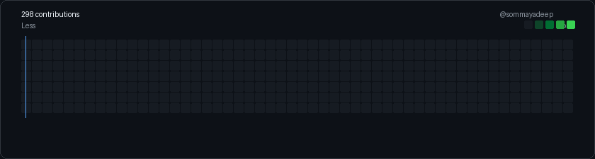

 

  
  
  

---

## About

B.Tech CSE (AI/ML) student at **SRM University AP**, batch of 2028.
I build machine learning models and the full-stack products around them.

- 💼 **2× Software Developer Intern** — built a full-stack e-commerce platform solo at *Purple Beans Agro Industries* (database → deployment)
- 🤖 Interested in **LLMs, RAG systems, and ML-powered web apps**
- 🎓 Currently building an LLM/agent project to add to my portfolio

---

## Stack

**AI / ML**

**Full-Stack**

**Tools**

---

## GitHub Stats

&nbsp;&nbsp;

---

open to internships · collaborations · building cool things

